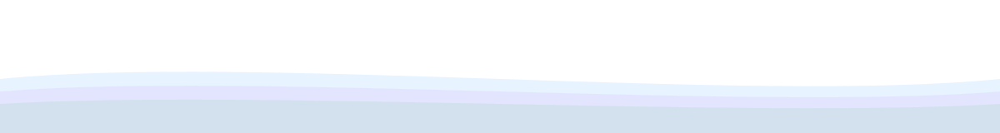

  

  <b>I build products people can touch.</b> Interactive web experiences where the engineering serves the product, 
  and I write down the <i>why</i> behind the decisions, not just the code.

---

## Products

### 🎂 Makemycake - a 3D cake configurator &nbsp;→&nbsp; [repo](https://github.com/Tripee-x/Tripee)

Design a cake and watch it come together live: pick a shape, flavours and decorations, and the cake renders in real time in Three.js. The loop closes with itemised pricing as you build and a kitchen-ready order docket when you're done.

> Built like a product, not a demo: Vitest unit tests plus Playwright e2e, visual-regression and axe-core accessibility suites.

### ☄️ Comet Aerospace - a cinematic, scroll-driven brand site &nbsp;→&nbsp; [repo](https://github.com/Tripee-x/comet-aerospace)

A brand story told in motion: a procedural Three.js hero that evolves across eight phases over a long pinned scroll. React Three Fiber + GSAP.

---

## Stack

  
  
  
  
  
  
  
  
  
  

  

